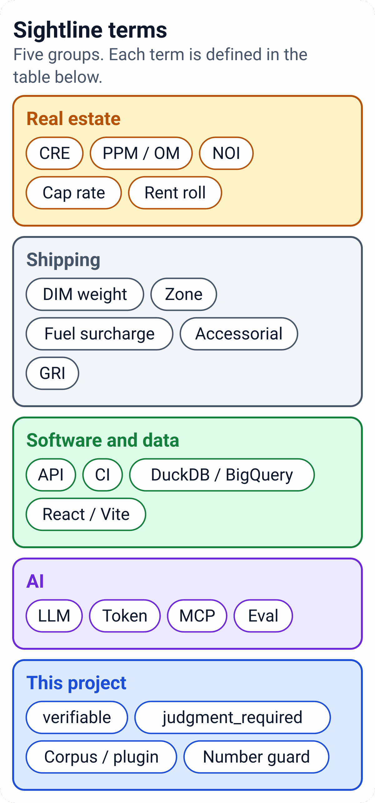

# Glossary

Every acronym and specialist term used in this repository, in plain language.

<picture>
  <source media="(prefers-color-scheme: dark)" srcset="docs/img/glossary-dark.png">
  
</picture>

## Real estate (corpus #1)

| Term | Stands for | Meaning |
| --- | --- | --- |
| CRE | commercial real estate | Property owned to earn income: apartments, offices, retail, industrial. |
| Deal room | — | The shared folder of documents a sponsor gives prospective investors. |
| Sponsor | — | The firm that finds, organizes and manages the deal. |
| Diligence | — | The checks an investor runs before committing money. |
| OM | offering memorandum | The sponsor's marketing summary of the deal. |
| PPM | private placement memorandum | The legal offering document: fees, risks, terms. It governs when it disagrees with the OM. |
| PSA | purchase and sale agreement | The contract to buy the property. |
| T-12 | trailing 12 months | Last year's actual income and expenses. |
| Rent roll | — | Unit-by-unit list of tenants, rents and lease status. |
| Pro forma | — | Projected future income and expenses. |
| NOI | net operating income | Rent collected minus operating costs, before loan payments. |
| Cap rate | capitalization rate | NOI ÷ property value. A lower cap rate means a higher price. The **exit cap** is the rate assumed when selling. |
| IRR | internal rate of return | Annualized return that accounts for when cash arrives. |
| MOIC | multiple on invested capital | Total cash returned ÷ cash invested (2.0x doubles your money). |
| Multifamily, value-add | — | Apartment building bought to improve and re-rent at higher rents. |
| Occupancy: in-place, stabilized, lease-up | — | Share of units rented today; the steady level after improvements; the period of filling vacancies. |
| Waterfall | — | The order in which profits are split between investors and the sponsor. |
| IR | investor relations | The team that talks to investors. |

## Shipping (corpus #2)

| Term | Stands for | Meaning |
| --- | --- | --- |
| Rate agreement | — | The shipper's contract with a carrier: discounts, fees, rules. |
| List rate | — | The carrier's published price before discounts. |
| DIM weight | dimensional weight | Length × width × height ÷ a divisor (139 here). Carriers bill the larger of DIM and actual weight. |
| Zone | — | Distance band between origin and destination (2–8). Higher zone, higher price. |
| Fuel surcharge | — | A weekly percentage added to freight charges. |
| Accessorial | — | Any add-on fee: residential delivery, address correction, large package. |
| GRI | general rate increase | The yearly list-price increase carriers announce (5.9% average for 2027). |
| Tracking number | — | The unique ID of one package. Billed twice = a duplicate. |
| Consignee | — | The person or business receiving the package. |

## Vendor billing (template)

| Term | Stands for | Meaning |
| --- | --- | --- |
| SaaS | software as a service | Software rented by subscription. |
| MSA | master services agreement | The main contract between a vendor and a customer. |

## Software and data

| Term | Stands for | Meaning |
| --- | --- | --- |
| API | application programming interface | How other software talks to this one (here, over HTTP). |
| HTTP 400 / 413 / 415 / 422 | — | Error codes: bad request / files too large / wrong file type / input didn't reconcile. |
| CLI | command-line interface | Running the tool by typing commands, e.g. `sightline audit`. |
| UI | user interface | The web page you click on. |
| CSV | comma-separated values | Plain-text spreadsheet format. |
| XLSX | — | Excel workbook file. |
| PDF | Portable Document Format | Fixed-layout document file. |
| JSON | JavaScript Object Notation | A common text format for structured data. |
| SQL | Structured Query Language | The language databases are queried in. |
| DuckDB | — | An analytics database that runs inside the app; no server needed. |
| BigQuery | — | Google Cloud's managed data warehouse for large-scale analytics. |
| FastAPI | — | Python framework for building web APIs. |
| React, Vite | — | JavaScript library for web interfaces; tool that builds it for the browser. |
| Streamlit | — | Python library for quick data web apps (used by the original prototype). |
| uv | — | Fast Python package and environment manager. |
| npm | Node package manager | Installs JavaScript dependencies for the web page. |
| CI | continuous integration | Automated checks that run on every code push. |
| GitHub Actions | — | GitHub's automation service that runs the CI here. |
| Lint, ruff, pytest | — | Style checks; the linter used; the Python test runner. |
| Decimal | — | Exact base-10 arithmetic, so cents never round wrong. |
| USD | United States dollars | |

## AI

| Term | Stands for | Meaning |
| --- | --- | --- |
| AI | artificial intelligence | Here, always a large language model. |
| LLM | large language model | A model that reads and writes text, such as Claude (Anthropic) or Gemini (Google). |
| Small / large model tier | — | Cheap, fast model for reading; stronger model for reasoning and writing. |
| Token | — | The unit models read and bill by, about ¾ of a word. |
| Structured outputs | — | A model setting that forces replies to match a fixed data shape. |
| MCP | Model Context Protocol | An open standard that lets AI apps call outside tools and data. |
| Mock | — | A recorded stand-in used instead of a real model (offline mode and CI). |
| Eval | evaluation | An automated test that scores accuracy against known answers. |
| Precision | — | Of everything flagged, the share that was really wrong. |
| Recall | — | Of everything really wrong, the share that was flagged. |

## This project's own terms

| Term | Meaning |
| --- | --- |
| Corpus (plural corpora) | One kind of document set plus the rules for checking it (CRE deal room, parcel invoices). |
| Plugin | The module that adds one corpus without changing the engine core. |
| Governing document | The document everything else must agree with (rate agreement, PPM, MSA). |
| Finding | One problem: dollar amount, citation, explanation, dispute note. |
| Citation | Exact file plus row or page, with a snippet, behind a finding. |
| `verifiable` | Provably wrong from the documents; comes with an amount. |
| `judgment_required` | Needs a person; evidence shown, no verdict given. |
| Mapping / reconciliation | Matching file columns to the schema; then proving row count and totals match the file's own stated totals. |
| Heuristic mapper | The offline, no-AI column matcher that uses known header names. |
| Number guard | Rule that discards any AI text containing a number the code didn't produce. |
| Seeded issue | An error planted on purpose so the eval can score the engine. |
| Stress test | An eval with deliberately unfriendly inputs, to show what gets rejected. |
| Ledger | Per-run record of model calls, tokens and cost. |
