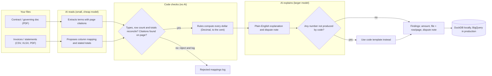

# Sightline

**An audit engine for document-heavy work where the numbers have to be right.** It reads contracts, invoices and deal documents in any layout, checks every line against the agreed terms, and hands you a list of problems. Each problem comes with the dollar amount, the exact file and row or page it came from, and a draft dispute note.

> **Code computes, AI explains.** The AI reads messy documents and writes the explanations. Plain, tested code does every calculation. The AI cannot add a number to a finding: if its text contains a figure the code did not produce, that text is thrown away.

---

## Where it came from, and where it works now

Sightline started as a tool for **commercial real estate (CRE) investment diligence**: reading a deal room (offering memo, PPM, rent roll, pro forma, market study) and catching numbers that disagree between documents.

Spend audits have the same structure: a governing document, a pile of documents that should follow it, and a person who has to sign off. So the engine was split into a domain-neutral core plus one plugin per kind of document set:

| Use case | Governing document | Checked documents | Typical catches |
| --- | --- | --- | --- |
| CRE deal room *(corpus #1)* | PPM | OM, pro forma, rent roll, market study | fee mismatches, exit cap below market, occupancy jumps with no plan |
| Parcel / carrier spend *(corpus #2)* | carrier rate agreement | invoices (CSV, Excel, PDF) | duplicate billing, wrong zone, DIM-weight errors, missed discounts, wrong fuel % |
| Vendor / SaaS billing *(template)* | order form / MSA | monthly invoices | price drift, seat overcounts, extension errors |

A new domain is a config file, a data folder and a plugin file (see [`corpora/_template`](corpora/_template) and [docs/ARCHITECTURE.md](docs/ARCHITECTURE.md#adding-a-corpus)).

## How it works



Every finding is labelled one of two ways:

- **verifiable**: provably wrong from the documents (e.g. a residential fee on a line the invoice itself marks commercial). Comes with a dollar amount.
- **judgment_required**: needs a person (e.g. a residential fee on a "Design Studio LLC, Ste 210", which might be a home business). The system shows the evidence and says what to check, and never gives a verdict.

## What it caught

Both corpora are **synthetic**: fictional companies, generated figures, and errors planted on purpose so the results can be scored. Numbers below come from `uv run python eval/run_eval.py`.

### Parcel invoices vs rate agreement (301 invoice lines across CSV, Excel and PDF)

| Planted problem | Type | Caught | Amount computed |
| --- | --- | --- | --- |
| Same tracking number billed in September and again in November | verifiable | yes | $26.11 |
| Billed at 15 lb; actual 6 lb, DIM 7 lb | verifiable | yes | $3.99 |
| Residential fee on a commercial address | verifiable | yes | $4.85 |
| Address-correction fee billed twice for one package | verifiable | yes | $18.00 |
| 30% 2-Day discount not applied | verifiable | yes | $22.43 |
| Billed as zone 7, contract zone chart says zone 5 | verifiable | yes | $3.64 |
| Whole November invoice at 9.25% fuel vs 8.50% in contract | verifiable | yes | $23.40 |
| Line total $10 higher than its own charges | verifiable | yes | $10.00 |
| Residential fee on a consignee that looks like a business | judgment_required | yes | (needs a human) |
| $31.50 "large package" charge the contract doesn't price | judgment_required | yes | (needs a human) |

**10 of 10 caught, 0 false alarms, all 8 amounts correct to the cent.** Total verifiable overbilling found: **$112.42** on ~$11.5k of invoices.

### CRE deal room (synthetic "Larkveil Residences", 8 PDFs)

| Planted problem | Type | Caught | Amount computed |
| --- | --- | --- | --- |
| Acquisition fee 2.0% in OM vs 2.75% in PPM | verifiable | yes | $208,500 |
| Exit cap 5.0% vs market study 5.5-6.0% | verifiable | yes | $3,966,522 lower exit value at market midpoint |
| Year-1 occupancy 94% vs 87.8% today, no lease-up plan | verifiable | yes | 6.2-point gap |
| "Never lost investor capital" vs a break-even exit | judgment_required | yes | (needs a human) |

**4 of 4 caught. Precision 0.80**: one extra judgment item ("cap rates are widening") was surfaced that wasn't planted. It's a fair point, but the score counts it against us.

### Read these numbers carefully

- **These results were produced offline, with no AI model called.** No API key was available when they were recorded. Column mapping ran on the built-in header-matching fallback, and the CRE "AI extraction" was a hand-recorded answer file, checked against the PDFs the same way live output is. So these scores test the **checking and arithmetic layer**, not a model. Add a key and re-run to score a real model; expect it to differ.
- **The planted errors and the rules were written by the same author.** A perfect score on your own test is the minimum bar, not proof. Real invoices are messier (see Known limits).
- **Under stress, recall drops to 1 of 10**, on purpose. `eval/stress_parcel.py` renames every CSV header to names the offline mapper has never seen and changes one invoice's stated total by $1. Both files are **rejected rather than trusted**, so their issues are missed. With an AI key the renamed headers should map; the tampered total will still be rejected, because no mapping can make a wrong total reconcile.

## Quick start

You need [uv](https://docs.astral.sh/uv/) (one install). Then, from the repo folder:

```bash
uv run sightline audit parcel_invoices
```

That installs dependencies on first run, audits the bundled synthetic invoices, and prints each finding with its citation and the AI token cost (zero offline). More:

```bash
uv run python eval/run_eval.py              # precision/recall table for both corpora
uv run python eval/stress_parcel.py         # what happens with unfriendly inputs
uv run sightline scenario gri --pct 5.9     # impact of a 5.9% carrier rate increase, by service
uv run sightline serve                      # API on http://127.0.0.1:8000 (POST /audit, GET /health)
cd web && npm install && npm run build      # then `sightline serve` also serves the upload page
cp .env.example .env                        # add ANTHROPIC_API_KEY or GEMINI_API_KEY to use a real model
```

## Built on the usual startup stack

| Need | Here |
| --- | --- |
| API | FastAPI (`api/main.py`): `POST /audit`, `GET /health` |
| Warehouse | DuckDB locally; tables and views written in SQL that also runs on BigQuery ([how to switch](docs/RUNBOOK.md#switching-to-bigquery)) |
| Models | Claude or Gemini, chosen per agent in `agents/llm.py`; cheap extraction on a small model, reasoning on a large one; token cost printed every run |
| UI | React + Vite page to upload files and browse findings with citations |
| CI | GitHub Actions: lint, tests, both evals (AI calls replaced by offline stand-ins when no key is set) |

## Known limits

- **Synthetic data only.** Real carrier invoices include credits, multi-piece shipments, international duties, weekly fuel tables and dozens of accessorials this demo does not model.
- **Contract terms are read by a clause and table parser**, then verified against the page text. An AI contract extractor feeding the same verification step is the obvious next step; it isn't built yet.
- **The offline column mapper only knows header names it has synonyms for.** Unfamiliar layouts need an AI key, or they get rejected (safely).
- **The CRE fact list is fixed** (fees, occupancy, cap rates, NOI, price). Facts outside it are not cross-checked.
- **Judgment items depend on the model.** Offline, they come from a recorded file; with a key, what gets surfaced will vary from run to run.
- **Single-tenant demo.** No auth, no multi-user, files are processed in a temp directory and not kept. Don't upload confidential data to a shared deployment.
- **GRI scenario** applies one percentage to every list rate. Real increases differ by service and zone.

## Repo map

```
api/            FastAPI service
agents/         LLM router (Claude/Gemini/offline), plus the original CRE agents
sightline/      engine core: schema, plugin registry, ingestion + mapping validation, explainer, store, CLI
corpora/        one folder per domain: cre_dealroom, parcel_invoices, _template
data/           synthetic sample packs and their generators
eval/           seeded ground truth, eval runner, stress test, offline fixtures
web/            React upload/browse page
app/, server/   original Streamlit explorer and MCP server for the CRE corpus
docs/           ARCHITECTURE, RUNBOOK, design notes
```

## License

MIT. See [LICENSE](LICENSE).

**All data in this repository is synthetic.** Every company, person, property, street and city in the sample packs is invented, and each name was checked against public listings to make sure it does not belong to a real business or property. No real deal, carrier, shipper or customer data is included, and none was used to build the samples.
