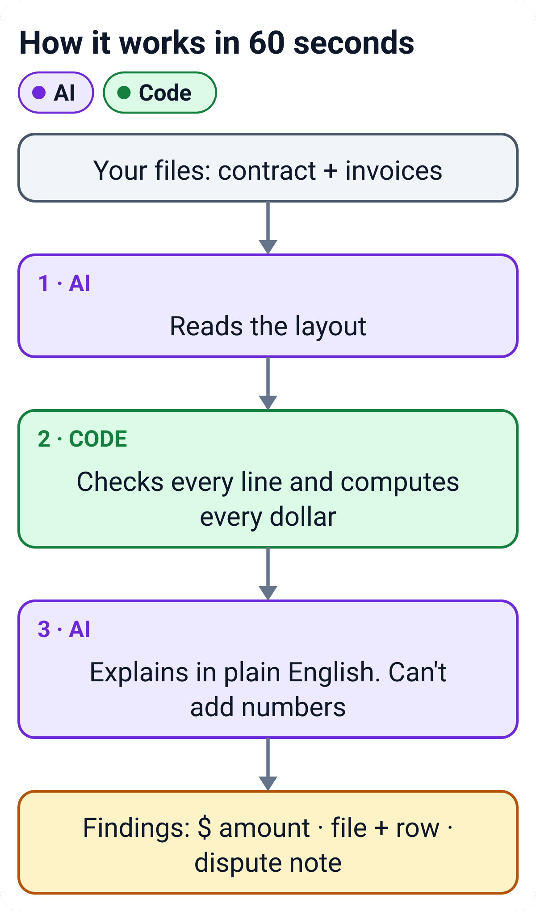
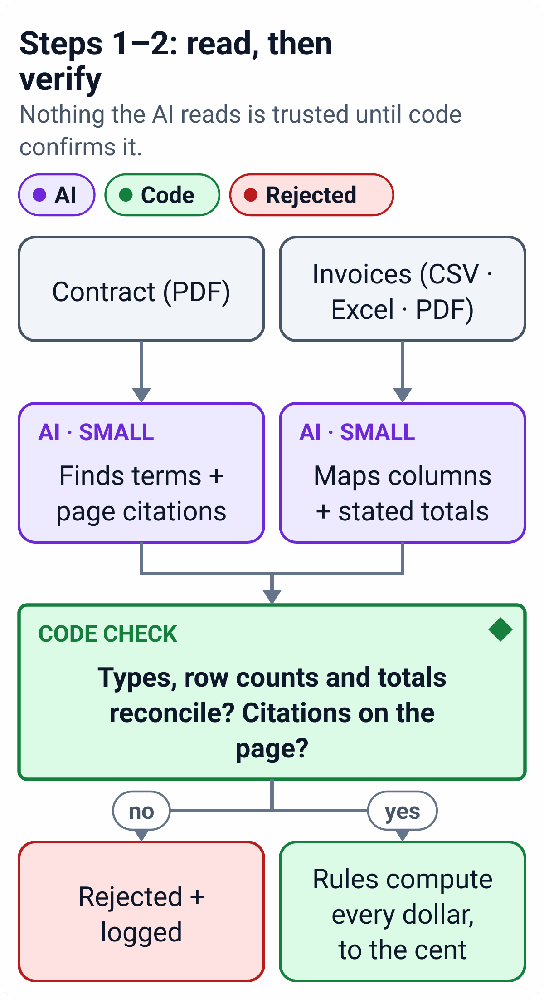
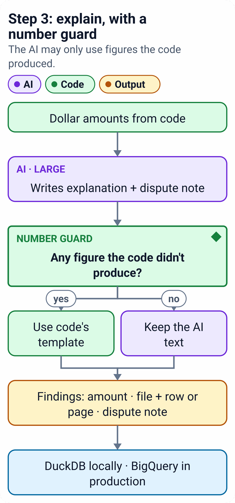
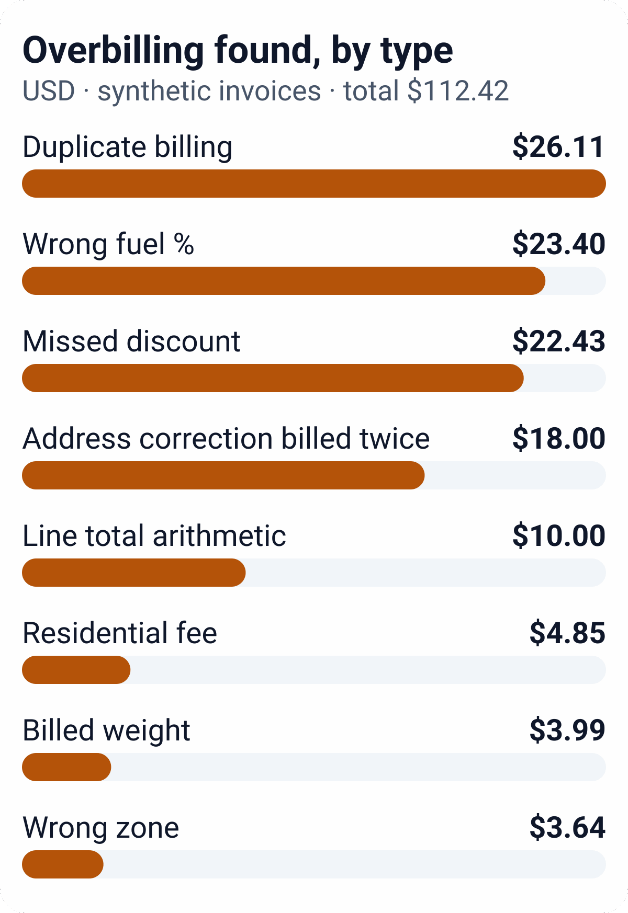
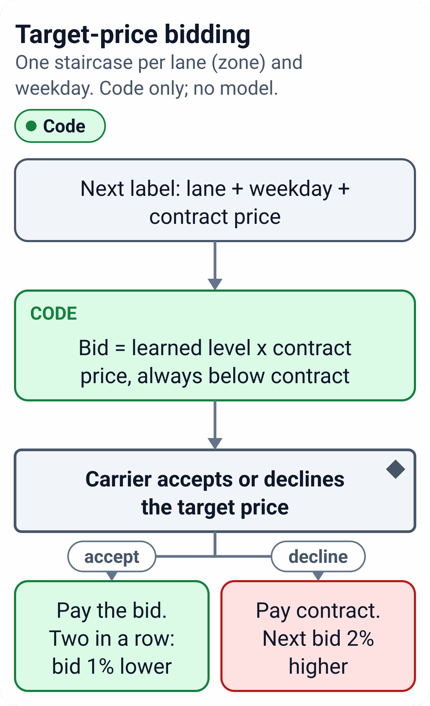

# Sightline

**An audit engine for document-heavy work where the numbers have to be right.** It reads contracts, invoices and deal documents in any layout, checks every line against the agreed terms, and hands you a list of problems. Each problem comes with the dollar amount, the exact file and row or page it came from, and a draft dispute note.

> **Code computes, AI (artificial intelligence) explains.** The AI reads messy documents and writes the explanations. Plain, tested code does every calculation. The AI cannot add a number to a finding: if its text contains a figure the code did not produce, that text is thrown away.

> New to a term? Every acronym is spelled out the first time it appears, and all of them live in the [Glossary](GLOSSARY.md).

<picture>
  <source media="(prefers-color-scheme: dark)" srcset="docs/img/overview-dark.png">
  
</picture>

| Who | Does | Never does |
| --- | --- | --- |
| AI (small model) | reads messy headers, finds contract terms | calculates |
| Code | validates, reconciles totals, computes every dollar | guesses |
| AI (large model) | writes explanations and dispute notes | adds a number |
| Person | decides `judgment_required` items | — |

---

## Where it came from, and where it works now

Sightline started as a tool for **commercial real estate (CRE) investment diligence (pre-investment checks)**: reading a deal room (offering memo (OM, the sponsor's marketing summary), PPM (private placement memorandum), rent roll (unit-by-unit rent list), pro forma (projected future financials), market study) and catching numbers that disagree between documents.

Spend audits have the same structure: a governing document, a pile of documents that should follow it, and a person who has to sign off. So the engine was split into a domain-neutral core plus one plugin (drop-in domain module) per kind of document set:

| Use case | Governing document | Checked documents | Typical catches |
| --- | --- | --- | --- |
| CRE deal room *(corpus #1)* | PPM | OM (offering memorandum), pro forma, rent roll, market study | fee mismatches, exit cap rate (capitalization rate = income ÷ price) below market, occupancy jumps with no plan |
| Parcel / carrier spend *(corpus #2)* | carrier rate agreement | invoices (CSV (comma-separated values), Excel, PDF (Portable Document Format)) | duplicate billing, wrong zone (distance band), DIM (dimensional)-weight errors, missed discounts, wrong fuel % (fuel surcharge percentage) |
| Vendor / SaaS (software as a service) billing *(template)* | order form / MSA (master services agreement) | monthly invoices | price drift, seat overcounts, extension errors |

A new domain is a config file, a data folder and a plugin file (see [`corpora/_template`](corpora/_template) and [docs/ARCHITECTURE.md](docs/ARCHITECTURE.md#adding-a-corpus)).

## How it works

<picture>
  <source media="(prefers-color-scheme: dark)" srcset="docs/img/read-check-dark.png">
  
</picture>

<picture>
  <source media="(prefers-color-scheme: dark)" srcset="docs/img/explain-dark.png">
  
</picture>

Every finding is labelled one of two ways:

- **verifiable**: provably wrong from the documents (e.g. a residential fee on a line the invoice itself marks commercial). Comes with a dollar amount.
- **judgment_required**: needs a person (e.g. a residential fee on a "Design Studio LLC, Ste 210", which might be a home business). The system shows the evidence and says what to check, and never gives a verdict.

Credit and adjustment lines are money too. Amounts written as `-12.50`, `(12.50)`, `12.50-` or `12.50 CR` all parse as negative, and they count toward the invoice total that must reconcile to the cent. A reader (human or model) that skips credits because they "aren't costs" produces a total that disagrees with the invoice, and the file is rejected instead of quietly misreported. Credits also net against duplicate charges on the same tracking number, so a duplicate the carrier already refunded is never claimed twice.

## What it caught

Both corpora (document sets plus their rules) are **synthetic**: fictional companies, generated figures, and errors planted on purpose so the results can be scored. Numbers below come from `uv run python eval/run_eval.py`.

### Parcel invoices vs rate agreement (301 invoice lines across CSV, Excel and PDF)

| Planted problem | Type | Caught | Amount computed |
| --- | --- | --- | --- |
| Same tracking number billed in September and again in November | verifiable | yes | $26.11 |
| Billed at 15 lb; actual 6 lb, DIM 7 lb | verifiable | yes | $3.99 |
| Residential fee on a commercial address | verifiable | yes | $4.85 |
| Address-correction fee billed twice for one package | verifiable | yes | $18.00 |
| 30% 2-Day discount not applied | verifiable | yes | $22.43 |
| Billed as zone 7, contract zone chart says zone 5 | verifiable | yes | $3.64 |
| Whole November invoice at 9.25% fuel vs 8.50% in contract | verifiable | yes | $23.40 |
| Line total $10 higher than its own charges | verifiable | yes | $10.00 |
| Residential fee on a consignee that looks like a business | judgment_required | yes | (needs a human) |
| $31.50 "large package" charge the contract doesn't price | judgment_required | yes | (needs a human) |

<picture>
  <source media="(prefers-color-scheme: dark)" srcset="docs/img/overbilling-dark.png">
  
</picture>

**10 of 10 caught, 0 false alarms, all 8 amounts correct to the cent.** Total verifiable overbilling found: **$112.42** on ~$11.5k of invoices.

### CRE deal room (synthetic "Larkveil Residences", 8 PDFs)

| Planted problem | Type | Caught | Amount computed |
| --- | --- | --- | --- |
| Acquisition fee 2.0% in OM vs 2.75% in PPM | verifiable | yes | $208,500 |
| Exit cap 5.0% vs market study 5.5-6.0% | verifiable | yes | $3,966,522 lower exit value at market midpoint |
| Year-1 occupancy 94% vs 87.8% today, no lease-up plan | verifiable | yes | 6.2-point gap |
| "Never lost investor capital" vs a break-even exit | judgment_required | yes | (needs a human) |

**4 of 4 caught. Precision (share of flags that were real) 0.80**: one extra judgment item ("cap rates are widening") was surfaced that wasn't planted. It's a fair point, but the score counts it against us.

### Read these numbers carefully

- **These results were produced offline, with no AI model called.** No API (application programming interface) key was available when they were recorded. Column mapping ran on the built-in header-matching fallback, and the CRE "AI extraction" was a hand-recorded answer file, checked against the PDFs the same way live output is. So these scores test the **checking and arithmetic layer**, not a model. Add a key and re-run to score a real model; expect it to differ.
- **The planted errors and the rules were written by the same author.** A perfect score on your own test is the minimum bar, not proof. Real invoices are messier (see Known limits).
- **Under stress, recall (share of real problems caught) drops to 1 of 10**, on purpose. `eval/stress_parcel.py` renames every CSV header to names the offline mapper has never seen and changes one invoice's stated total by $1. Both files are **rejected rather than trusted**, so their issues are missed. With an AI key the renamed headers should map; the tampered total will still be rejected, because no mapping can make a wrong total reconcile.

## Quick start

You need [uv](https://docs.astral.sh/uv/) (a fast Python package manager; one install). Then, from the repo folder:

```bash
uv run sightline audit parcel_invoices
```

That installs dependencies on first run, audits the bundled synthetic invoices, and prints each finding with its citation and the AI token (units AI models bill by) cost (zero offline). More:

```bash
uv run python eval/run_eval.py              # precision/recall table for both corpora
uv run python eval/stress_parcel.py         # what happens with unfriendly inputs
uv run sightline scenario gri --pct 5.9     # impact of a 5.9% carrier rate increase, by service
uv run sightline scenario dim --divisor 166 # what a better DIM (dimensional weight) divisor is worth
uv run sightline serve                      # API on http://127.0.0.1:8000 (POST /audit, GET /health)
cd web && npm install && npm run build      # then `sightline serve` also serves the upload page
cp .env.example .env                        # add ANTHROPIC_API_KEY or GEMINI_API_KEY to use a real model
```

### Try it on the 2027 rate season

The three US national carriers each announced an average **5.9%** increase for 2027: UPS on Dec 21, 2026 ([Supply Chain Dive](https://www.supplychaindive.com/news/ups-plans-59-rate-increase-on-dec-21/872751/)), FedEx on Jan 4, 2027 ([FedEx surcharge changes](https://www.fedex.com/content/dam/fedex/us-united-states/services/surcharge_and_fee_changes_2027.pdf)) and USPS on Jan 17, 2027, pending approval ([USPS](https://about.usps.com/newsroom/national-releases/2026/1112-usps-recommends-shipping-price-adjustments-for-2027.htm)). Two levers worth pricing before renewal:

| Command | Sample result (299 unique shipments) |
| --- | --- |
| `sightline scenario gri --pct 5.9` | what the increase adds, by service, after contract discounts |
| `sightline scenario dim --divisor 166` | contract divisor 139 → 166 re-weighs 66 shipments and saves **$158.48** (1.5%) |
| `sightline scenario floor --labels 3000` | target-price bidding: the floor learner saves **11.7%** vs 9.4% for a fixed 10%-below bid (details below) |

### Target-price bidding: learning each carrier's floor

Some carriers now let a shipper name a target price per label. The carrier accepts it if it has spare capacity, or declines and the contract rate applies. The carrier never says what its lowest price is, so the savings go to whoever can work out that floor by lane and day, label after label.

<picture>
  <source media="(prefers-color-scheme: dark)" srcset="docs/img/floor-dark.png">
  
</picture>

A decline costs the whole discount, so the learner ([`floor.py`](corpora/parcel_invoices/floor.py)) is a staircase per lane (zone) and weekday: two accepts in a row and it bids 1% of contract lower; any decline and it steps 2% back up. A new lane starts from its zone's level. It never bids at or above contract, and it re-adapts on its own when capacity tightens (tested).

Replaying the 299 sample shipments as 3,000 labels against a **synthetic** carrier whose hidden floors vary by zone and weekday (`seed 7`; seeds 1–3 give the same picture):

| Strategy | Paid | Saved | Accepted |
| --- | ---: | ---: | ---: |
| Always pay contract | $106,693.29 | — | — |
| Fixed bid 10% below contract | $96,673.20 | $10,020.09 (9.4%) | 92.7% |
| **Floor learner** | **$94,208.64** | **$12,484.65 (11.7%)** | 85.5% |
| Knew every floor (upper limit) | $88,683.01 | $18,010.28 (16.9%) | — |

The learner gets about 25% more savings than the fixed bid and about 70% of what perfect knowledge of every floor would give. A model is not needed to learn the floor; where one helps is explaining why a lane's level moved.

## Built on the usual startup stack

| Need | Here |
| --- | --- |
| API | FastAPI (Python web framework; `api/main.py`): `POST /audit`, `GET /health` |
| Warehouse | DuckDB (embedded analytics database) locally; tables and views written in SQL (Structured Query Language) that also runs on BigQuery ([how to switch](docs/RUNBOOK.md#switching-to-bigquery)) |
| Models | Claude (Anthropic) or Gemini (Google) large language models (LLMs), chosen per agent in `agents/llm.py`; cheap extraction on a small model, reasoning on a large one; token cost printed every run |
| UI (user interface) | React (web UI library) + Vite (web build tool) page to upload files and browse findings with citations |
| CI (continuous integration) | GitHub Actions (GitHub's automation service): lint, tests, both evals (evaluations against known answers; AI calls replaced by offline stand-ins when no key is set) |

## What I'd build next

| Next | Why it matters | How it fits this design |
| --- | --- | --- |
| **Live target-price bidding** against a carrier's rating API | The learner above, pointed at real accept/decline responses | Same staircase; outcomes logged to the warehouse so every bid is auditable |
| **New carrier layouts without new code** (regional carriers bought through label marketplaces) | More carriers means more invoice formats | Already the mapping path: AI proposes columns, reconciliation decides |
| **Negotiation pack** from audit data | Rate-renewal asks backed by the shipper's own numbers | GRI and DIM scenarios above, extended per zone and per surcharge |
| **AI contract extractor** feeding the existing term verification | Real agreements vary more than the synthetic one | Same rule as everywhere: the model proposes, the citation check disposes |

## Known limits

- **Synthetic data only.** Credits are parsed, reconciled, and netted against duplicate charges by tracking number (a refunded duplicate is not claimed again); adjustments with no shipment on the invoices go to a person. Matching a credit to one specific accessorial on a multi-charge line isn't built. Multi-piece shipments, international duties, weekly fuel tables and dozens of accessorials (add-on fees) are not modelled.
- **Contract terms are read by a clause and table parser**, then verified against the page text. An AI contract extractor feeding the same verification step is the obvious next step; it isn't built yet.
- **The offline column mapper only knows header names it has synonyms for.** Unfamiliar layouts need an AI key, or they get rejected (safely).
- **The CRE fact list is fixed** (fees, occupancy, cap rates, NOI (net operating income), price). Facts outside it are not cross-checked.
- **Judgment items depend on the model.** Offline, they come from a recorded file; with a key, what gets surfaced will vary from run to run.
- **Single-tenant demo.** No auth, no multi-user, files are processed in a temp directory and not kept. Don't upload confidential data to a shared deployment.
- **GRI (general rate increase) scenario** applies one percentage to every list rate. Real increases differ by service and zone. The **DIM scenario** changes only the divisor; carriers may change minimums or surcharges alongside it. The **floor scenario** runs against a synthetic carrier; real target-price programs can require minimum weekly volume and may change floors in ways this model does not capture.

## Repo map

```
api/            FastAPI service
agents/         LLM router (Claude/Gemini/offline), plus the original CRE agents
sightline/      engine core: schema, plugin registry, ingestion + mapping validation, explainer, store, CLI
corpora/        one folder per domain: cre_dealroom, parcel_invoices, _template
data/           synthetic sample packs and their generators
eval/           seeded ground truth, eval runner, stress test, offline fixtures
web/            React upload/browse page
app/, server/   original Streamlit explorer and MCP server for the CRE corpus
docs/           ARCHITECTURE, RUNBOOK, design notes
GLOSSARY.md     every acronym and term, defined
```

## License

MIT. See [LICENSE](LICENSE).

**All data in this repository is synthetic.** Every company, person, property, street and city in the sample packs is invented, and each name was checked against public listings to make sure it does not belong to a real business or property. No real deal, carrier, shipper or customer data is included, and none was used to build the samples.
