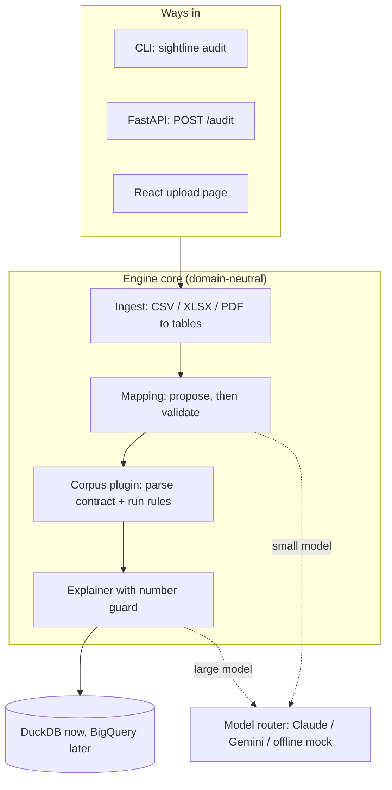

# Architecture

> New to a term? Every acronym is spelled out the first time it appears, and all of them live in the [Glossary](../GLOSSARY.md).



## The one rule

**Models read and write prose. Code computes and decides.**

| Step | Who | Can it introduce a number? | Guard |
| --- | --- | --- | --- |
| Map columns / read stated totals | small model (or offline heuristic (rule-based, no AI)) | proposes only | `validate()` re-parses every row, reconciles row count and total to the cent, and checks stated totals literally appear in the document |
| Extract contract / deal facts | parser or small model | proposes only | each value must appear in a snippet that appears on the cited page |
| Rules | code | yes: this is the only place | unit tests per rule (`tests/test_rules.py`) |
| Explain + dispute note | large model | no | any number not in the finding's facts/citations voids the text; the code template is used instead |
| Judgment items | large model | no amount allowed | always `judgment_required`; evidence must be found on the cited page |

## Layout

```
sightline/
  core/schema.py       Finding, Citation, AuditResult (domain-neutral)
  core/plugins.py      discovers corpora/*/corpus.toml, loads plugin classes
  core/engine.py       run_audit(): plugin -> findings -> cost ledger -> store
  core/explain.py      LLM explainer with the number guard
  core/store.py        DuckDB tables + BigQuery-compatible views
  ingest/tables.py     CSV / XLSX / PDF -> RawTable (format-aware, sender-agnostic)
  ingest/mapping.py    propose (LLM | heuristic) -> validate -> trusted rows | rejection log
  cli.py               audit, scenario gri, serve, corpora
agents/llm.py          provider router: anthropic | gemini | mock; tiers; per-agent overrides; ledger
corpora/<name>/        corpus.toml + plugin.py (+ domain modules)
api/main.py            FastAPI
web/                   React (Vite)
```

## Data flow (parcel corpus)

1. `_split` finds the contract by a marker phrase on page 1 (`contract_marker` in `corpus.toml`).
2. `parse_rate_agreement` reads clauses and schedules; `verify_terms` checks completeness
   (21 service x zone (distance band) rates and discounts), ranges, zone-chart coverage, and that each scalar
   term appears verbatim on its cited page.
3. Each invoice becomes a `RawTable`. `ingest_table` tries the LLM (large language model) proposer (when a key is
   set), then the heuristic one. The first mapping that validates wins. Every failure goes
   to `runs/rejected_mappings.jsonl` and the `rejected_mappings` table.
4. `rules.run_all` runs seven checks. Transport overcharges are attributed to exactly one
   cause per line (zone > weight > missed discount > other) so nothing is double counted.
   Fuel is checked against *billed* freight so a fuel error and a freight error on the same
   line don't overlap.
5. Findings get citations (file + row/page + a snippet of the line, plus the contract clause)
   and go to the explainer.

## Model routing

`AGENT_TIERS` in `agents/llm.py` maps each agent to `small` or `large`:

| Agent | Tier | Default Claude model | Default Gemini model |
| --- | --- | --- | --- |
| mapper, contract_extractor, cre_extractor, investor_qa | small | claude-haiku-5-5 | gemini-2.5-flash |
| explainer, judgment, risk, summarizer | large | claude-opus-5-5 | gemini-2.5-pro |

Override per tier (`SIGHTLINE_MODEL_SMALL=...`) or per agent
(`SIGHTLINE_MODEL_EXPLAINER=gemini:gemini-2.5-pro`). Claude calls use structured outputs (replies forced into a fixed shape)
(`output_config.format`) rather than forced tool choice. Each call is recorded in a ledger;
the CLI (command-line interface) prints tokens (units AI models bill by) and cost per agent. Prices for Claude models are built in; Gemini
prices are left to `SIGHTLINE_PRICE_<MODEL>` so the tool never prints a guessed cost
(unknown prices show as `n/a`). Gemini model ids change often: check them before use.

## Offline mode

With no key, `detect_provider()` returns `mock`. Structured calls are served by handlers
registered with `register_mock` (the CRE (commercial real estate) fixture), the mapper uses the heuristic proposer,
and the explainer uses templates. Everything downstream (verification, rules, store, API (application programming interface))
is identical, which is what CI (continuous integration) tests.

## Adding a corpus

1. `cp -r corpora/_template corpora/vendor_billing` and rename `corpus.toml.example` to
   `corpus.toml`. Set `name`, `plugin`, `data_dir`, `seeded_issues`, `accepts`.
2. In `plugin.py` define a `CanonicalSchema` for your rows. Add `synonyms` for the offline
   mapper; the LLM mapper works from field descriptions.
3. Parse and verify the governing document into typed terms.
4. Write checks as pure functions returning findings with Decimal (exact decimal arithmetic) amounts. Test each one.
5. Put sample files in `data/<name>/` and planted issues in `eval/seeded_issues_<name>.json`
   (`id`, `rule`, `keys`, `classification`, optional `expected_amount_usd`).
6. `uv run python eval/run_eval.py <name>`. The API, UI (user interface) and CLI pick it up automatically.

## Storage

See `core/store.py`. Tables: `runs`, `findings`, `citations`, `invoice_lines`,
`rejected_mappings`, `llm_calls`. Views: `v_findings_by_rule`, `v_recoverable_by_service`,
`v_run_cost`. View SQL (Structured Query Language) avoids DuckDB (embedded analytics database)-only syntax so it runs unchanged on BigQuery (Google Cloud data warehouse).

## What the original CRE prototype still provides

`app/streamlit_app.py` (deal sheet, investor Q&A (question and answer) with citations, memos, context inspector)
and `server/mcp_server.py` (the deal room (shared folder of deal documents) as MCP (Model Context Protocol) tools) still work against corpus (a document set plus its rules) #1 with a
model key. They predate the plugin (drop-in domain module) engine and are kept as an exploration UI.
