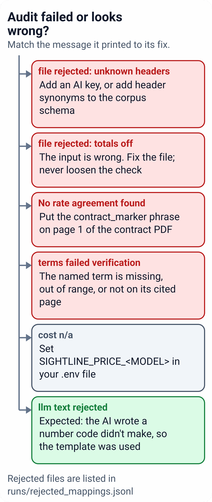

# Runbook

> New to a term? Every acronym is spelled out the first time it appears, and all of them live in the [Glossary](../GLOSSARY.md).

## Setup

```bash
uv sync                      # Python 3.12 deps (uv installs Python if needed)
cp .env.example .env         # optional: add a model key
cd web && npm ci && npm run build && cd ..   # optional: UI
```

## Everyday commands

| Task | Command |
| --- | --- |
| List corpora (document sets plus their rules) | `uv run sightline corpora` |
| Audit sample data | `uv run sightline audit parcel_invoices` / `cre_dealroom` |
| Audit your files | `uv run sightline audit parcel_invoices contract.pdf inv1.csv inv2.xlsx` |
| JSON (JavaScript Object Notation) output | add `--json` |
| Eval table | `uv run python eval/run_eval.py [--min-recall 1.0]` |
| Stress test | `uv run python eval/stress_parcel.py` |
| Rate-increase scenario | `uv run sightline scenario gri --pct 5.9` |
| API (application programming interface) + UI (user interface) | `uv run sightline serve` then open http://127.0.0.1:8000 |
| UI dev server | `cd web && npm run dev` (proxies to :8000) |
| Tests / lint | `uv run pytest -q` / `uv run ruff check .` |
| Regenerate data | `uv run python data/generate_parcel.py`, `uv run python data/generate_cre_dealroom.py` |

## API

```bash
curl localhost:8000/health
curl -F corpus=parcel_invoices \
     -F files=@data/parcel/rate_agreement.pdf -F files=@data/parcel/inv_2026-09.csv \
     localhost:8000/audit
```

Errors: `400` unknown corpus (a document set plus its rules), `413` too many/too large files, `415` wrong file type,
`422` input did not reconcile (the message lists why).

## Choosing models

| Variable | Effect |
| --- | --- |
| `ANTHROPIC_API_KEY` / `GEMINI_API_KEY` | enables that provider (auto-detected) |
| `SIGHTLINE_PROVIDER` | force `anthropic`, `gemini` or `mock` |
| `SIGHTLINE_MODEL_SMALL` / `_LARGE` | model per tier, `provider:model` allowed |
| `SIGHTLINE_MODEL_<AGENT>` | model for one agent, e.g. `SIGHTLINE_MODEL_MAPPER` |
| `SIGHTLINE_PRICE_<MODEL>` | `"in,out"` USD (US dollars) per 1M tokens (units AI models bill by) for cost reporting |
| `SIGHTLINE_DB` | DuckDB (embedded analytics database) file path (default `runs/sightline.duckdb`) |

## Troubleshooting

<picture>
  <source media="(prefers-color-scheme: dark)" srcset="img/runbook-dark.png">
  
</picture>


- **A file was rejected.** `runs/rejected_mappings.jsonl` (or the `rejected_mappings` table)
  lists each attempt and the reasons: unmapped required field, unparsable value, row count
  or total not matching the stated control totals. Fix the input or, offline, add header
  synonyms in the corpus schema. Never relax the reconciliation check to force a file in.
- **"No rate agreement found".** The contract PDF (Portable Document Format) must contain the `contract_marker` phrase
  from `corpus.toml` on page 1.
- **"Contract terms failed verification".** A term was missing, out of range, or not found
  verbatim on its cited page. The message names it.
- **Cost shows n/a.** The model has no price configured; set `SIGHTLINE_PRICE_<MODEL>`.
- **LLM (large language model) text says "template (llm text rejected: introduced numbers)".** The explainer wrote a
  number the code didn't produce, so its text was discarded. Expected occasionally.

## Switching to BigQuery

The DuckDB schema uses portable types and the views use SQL (Structured Query Language) both engines accept.

1. Create a dataset: `bq mk --dataset <project>:sightline`.
2. Create tables with the columns in `TABLES` (`sightline/core/store.py`), mapping
   `VARCHAR -> STRING`, `DOUBLE -> FLOAT64`, `INTEGER -> INT64`.
3. Export a run from DuckDB and load it:
   ```bash
   duckdb runs/sightline.duckdb "COPY findings TO 'findings.json' (FORMAT JSON)"
   bq load --source_format=NEWLINE_DELIMITED_JSON sightline.findings findings.json
   ```
   (repeat per table, or replace `store.save` with `google-cloud-bigquery`
   `insert_rows_json` calls for streaming).
4. Create the views from `VIEWS`, prefixing table names with `` `<project>.sightline.` ``.
5. Point dashboards at `v_findings_by_rule`, `v_recoverable_by_service`, `v_run_cost`.

A `store.save` backend switch (`SIGHTLINE_STORE=bigquery`) is not implemented yet.

## Releasing

CI (`.github/workflows/ci.yml`) must be green: lint, tests, both evals (evaluation against known answers) at full recall (share of real problems caught) in
offline mode, stress test, scenario smoke test, web build.
