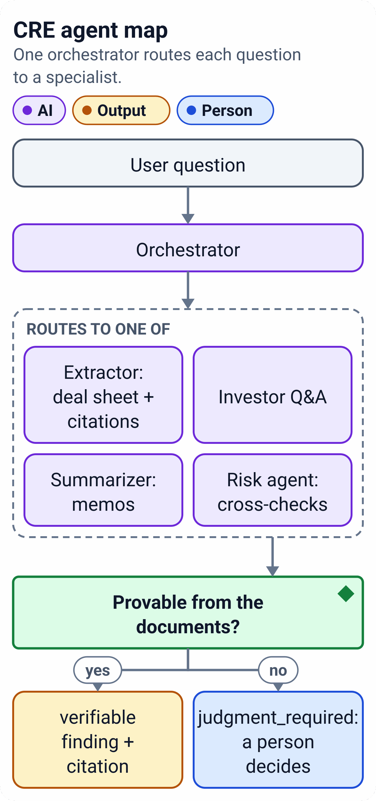

# Sightline — Build Spec (corpus #1: CRE deal room)

The original design for the first corpus (a document set plus its rules). The engine has since been
generalised into a plugin (drop-in domain module)-based document and spend audit engine — see
`ARCHITECTURE.md` for the current shape. This spec is kept because the CRE (commercial real estate)
corpus is still corpus #1 and its design choices carried over.

> New to a term? Every acronym is spelled out the first time it appears, and all of them live in the [Glossary](../GLOSSARY.md).

<picture>
  <source media="(prefers-color-scheme: dark)" srcset="img/agents-dark.png">
  
</picture>

## 1. What this is

A prototype that ingests a single real-estate **deal room (shared folder of deal documents)** (a folder of
offering documents) and produces two kinds of value off the same corpus:

- **Diligence side (internal):** extract a structured deal sheet, cross-check
  facts across documents, flag risks and inconsistencies, draft a diligence (pre-investment checks)
  memo.
- **Investor side (IR (investor relations)/growth):** answer investor questions with citations,
  auto-draft an investor-facing summary.

Same ingestion + retrieval pipeline, two audiences.

## 2. Design principles

1. **Show the judgment, don't describe it.** Every architectural choice
   should be a visible embodiment of the ideas in §3.
2. **Synthetic data only.** No real deal, ever. All content is fictional
   (see §5). Confidential-safe, portable.
3. **Legible over clever.** Plain Python + the Anthropic API (application programming interface) + a small MCP (Model Context Protocol)
   server. No heavyweight agent frameworks.
4. **Two features must not be cut:** the **context inspector** and the
   **judgment boundary** (§3).

## 3. Architecture, mapped to the thesis

| Thesis | Implementation |
| --- | --- |
| "The agent is the file" | Each document becomes a first-class object with extracted structured facts + provenance (source doc, page/section). |
| "Pathways to the file" | Retrieval is exposed as an MCP server with typed tools. |
| "Context management is the game" | A visible context-inspector panel logs exactly what context each agent received, what was excluded, and token (units AI models bill by) counts. |
| "A workforce of agents" | An orchestrator plus specialists: Extractor, Risk/Underwriter, Investor Q&A (question and answer), Summarizer. |
| "LLMs have no taste / judgment is the edge" | A judgment boundary: verifiable/computable questions get cited answers; the system refuses to fabricate verdicts on judgment-required items, surfacing them for a human instead. |

## 4. Technical design

### Stack
- Python 3.12, `uv` for env/deps
- Anthropic API (Claude); model configurable, key read from `ANTHROPIC_API_KEY`
- MCP server: FastMCP (Python library for MCP servers)
- Ingestion: `pdfplumber` (PDF text and table reader), `pypdf` (simpler PDF reader) as fallback
- Retrieval: keyword + simple in-memory chunk index (no vector DB needed for this corpus size)
- Schema/validation: `pydantic` (Python data-validation library)
- UI (user interface): Streamlit (Python data-app library; fast path); FastAPI (Python web framework) + React (web UI library) added later (see ARCHITECTURE.md)

### MCP tools
```
list_documents()      -> [{doc_id, title, type, pages}]
get_document(doc_id)  -> {text, provenance}
search_docs(query, k) -> [{chunk, doc_id, location, score}]
get_deal_terms()      -> DealSheet
get_financials()      -> Financials
flag_risks()          -> [RiskFinding]
```

### Agents
- **Orchestrator:** routes requests, assembles context, writes to the context log.
- **Extractor:** populates `DealSheet` + `Financials` with citations.
- **Risk/Underwriter:** cross-checks facts across documents, emits `RiskFinding`s tagged `verifiable` vs `judgment_required`.
- **Investor Q&A:** answers with citations; refuses/deflects judgment-required questions.
- **Summarizer:** drafts an internal diligence memo and an investor-facing summary.

### Context inspector
For every agent call, log and expose: system prompt used, retrieved context
(chunks / tool results), token counts in/out, what was excluded and why.

### Judgment boundary
- **Computable/verifiable** → answer with citations.
- **Judgment-required** → surface, don't answer. Return a structured
  "needs human judgment" object with evidence attached.

### Schema sketch
```
DealSheet:   property_name, address, units, strategy, purchase_price,
             target_hold_years, projected_irr, projected_moic,
             fees[], sources_uses, citations[]
Financials:  t12_noi, in_place_occupancy, unit_mix[], proforma_year1_noi,
             exit_cap_rate, market_cap_rate, citations[]
RiskFinding: id, title, severity(low/med/high), category,
             classification(verifiable|judgment_required),
             evidence[] (doc_id + location + quote-span), explanation
Citation:    doc_id, location(page/section), snippet
```

## 5. Synthetic data pack — "Larkveil Residences"

Fictional property: **Larkveil Residences — 148-unit multifamily value-add (buy, improve, re-rent higher),
in the fictional city of Marrowdale.** Figures are internally coherent except
for deliberately planted issues.

### Documents (PDFs under `data/cre_dealroom/`)
1. Offering Memorandum (OM)
2. PPM (private placement memorandum) excerpt (fees, risk factors, waterfall (profit-split order))
3. T-12 (trailing 12 months of actuals) operating statement
4. Rent roll
5. Pro forma (5-year projection)
6. Sponsor bio / track record
7. PSA (purchase and sale agreement) key terms
8. Market study excerpt

### Seeded inconsistencies (ground truth in `eval/seeded_issues.json`)
1. **Fee mismatch:** 2.0% (OM summary) vs 2.75% (PPM fee schedule) — verifiable.
2. **Exit cap too aggressive:** pro forma (projected future financials) exit cap tighter than market study's prevailing cap — verifiable contradiction; "is that reasonable" follow-on is judgment_required.
3. **Occupancy overstatement:** rent roll (unit-by-unit rent list) ~88% occupied today vs pro forma assuming 94% once stabilized (steady-state), with no lease-up (filling vacant units) plan — verifiable.
4. **Track-record spin** (optional): sponsor (deal organizer) bio claims "never lost investor capital" but timeline implies a return-of-capital-only prior exit — judgment_required.

## 6. Eval harness

`eval/run_eval.py` runs `flag_risks()` against Larkveil and checks each
seeded issue is caught, with the correct classification. Accuracy is
measured, not asserted.

## 7. Scope

**Built in this pass:** ingestion, DealSheet/Financials extraction with
citations, cited investor Q&A, risk-flag list catching seeded issues, thin
Streamlit UI, context inspector, eval (evaluation against known answers) harness.

**Deliberately deferred (said out loud, not silently cut):** auth/multi-user,
real connectors, FastAPI/React UI upgrade, multi-deal comparison, hosted
deployment.

## 8. Repo structure

See top-level README for the actual current layout.
