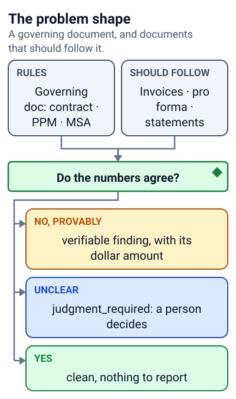

# Research brief — where automated document audit earns its keep

> New to a term? Every acronym is spelled out the first time it appears, and all of them live in the [Glossary](../GLOSSARY.md).

Background notes behind the design. Claims are directional, not citations;
where evidence is thin, it says so.

## 1. The problem shape

<picture>
  <source media="(prefers-color-scheme: dark)" srcset="img/problem-dark.svg">
  
</picture>

Many workflows share one structure: a pile of documents, a handful of
numbers that must agree across them, and a human who has to sign off.

| Workflow | Documents | Numbers that must agree |
| --- | --- | --- |
| CRE (commercial real estate) investment diligence (pre-investment checks) | offering memo (sponsor's marketing summary), PPM (private placement memorandum), T-12 (trailing 12 months of actuals), rent roll (unit-by-unit rent list), pro forma (projected future financials) | fees, occupancy, cap rates (capitalization rate = income ÷ price), NOI (net operating income) |
| Parcel / freight spend audit | carrier rate agreement, invoices | discounts, zones (distance band), surcharges, billed weight |
| Vendor / SaaS (software as a service) billing | MSA (master services agreement), order forms, monthly invoices | unit prices, seat counts, overage tiers |

The failure modes are also shared: a figure restated differently in two
places, a surcharge that the contract doesn't allow, a duplicate line, a
discount that silently fell off.

## 2. What the industry reports (moderate confidence)

- AI (artificial intelligence)-assisted document extraction (leases, invoices, statements) is widely
  reported at roughly 90–95% field-level accuracy. Vendors publish most of
  these figures, so treat them as directional.
- Parcel invoice audit is an established category. Common recoverable
  errors include duplicate billing, unearned or mis-applied accessorials (add-on fees)
  (residential, address correction), dimensional-weight errors and missed
  contract discounts. Published recovery estimates commonly land in the
  low single-digit percent of parcel spend.
- In-house finance teams rarely audit every line; sampling is the norm. A
  system that checks 100% of lines cheaply changes the economics.

## 3. Design implications

1. **Extraction is where LLMs help; arithmetic is where they hurt.** A
   model is good at reading a messy header row and saying "this column is
   the billed weight". It should never be the thing that multiplies.
2. **Every finding needs a citation** (file + page/row) or it isn't
   actionable in a dispute.
3. **Separate "provably wrong" from "needs a human".** Mixing them erodes
   trust in both.
4. **Score against planted ground truth.** Without a seeded eval (evaluation against known answers), accuracy
   claims are vibes.

## 4. Known gaps

- No single canonical peer-reviewed study on LLM (large language model)-based document audit was
  found; the evidence base is mostly practitioner and vendor reporting.
- Real carrier invoices vary much more than the synthetic pack here (credits,
  multi-piece shipments, international duties). See README "Known limits".
